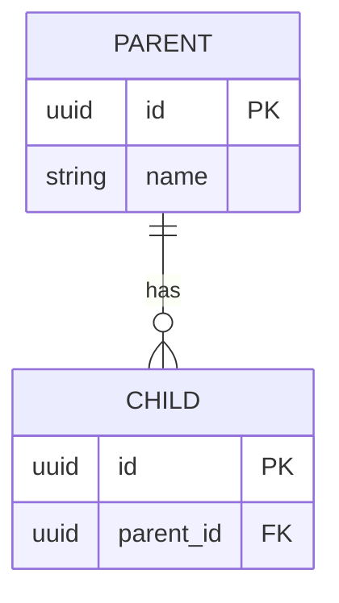

# 06 Data model

| Doc | Version | Status | Updated | Baseline |
|---|---|---|---|---|
| SPEC-06 | 0.1 | draft | {date} | application-definition {definition_version} |

## Entities
| DATA | Entity | Purpose | FRs | Personal data | Retention |
|---|---|---|---|---|---|

## Fields
One table per entity, headed by the entity's ID (the rows are fields, not new IDs).

| Field | Entity | Type | Required | Rule |
|---|---|---|---|---|

## Relationships
| REL | From | To | Cardinality | Rule |
|---|---|---|---|---|

An entity-relationship diagram once there are two or more entities (the database's tables and keys at tier 3 and above):

## Ownership, flows and source of truth
<Where each piece comes from.>

## Retention, deletion and migration
<Or "Not applicable: reason".>
