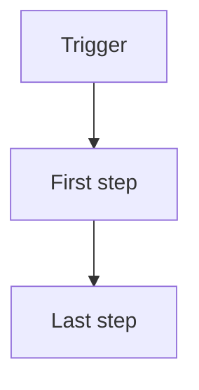

# 13 Business process

| Doc | Version | Status | Updated | Baseline |
|---|---|---|---|---|
| SPEC-13 | 0.1 | draft | {date} | application-definition {definition_version} |

How the work is done today, how it will be done with the app, and what changes. Plain enough for the people who do the work to check it. Each section needs a Mermaid flowchart; each to-be step names the requirements (FR) it relies on.

## As-is
<Who does what today, in order, including hand-offs, waits and rework.>

## To-be
<The same work with the app: what people still do, what the app does for them.>

| Step | Who | What happens | Relies on |
|---|---|---|---|

## What changes
Change is removed, automated, changed or new. The saving is the expected time or errors saved, per occurrence or per period.

| Step | Change | Who does it now | Who does it then | Expected saving |
|---|---|---|---|---|
