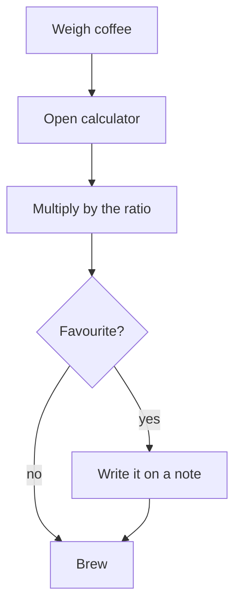
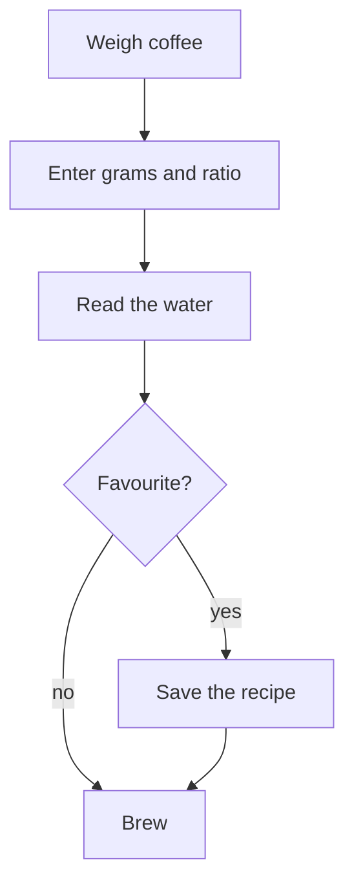

# 13 Business process

| Doc | Version | Status | Updated | Baseline |
|---|---|---|---|---|
| SPEC-13 | 0.1 | draft | 2026-10-19 | application-definition 1.0 |

## As-is
The brewer weighs the coffee, works out the water on a phone calculator, and writes favourite ratios on a sticky note.

## To-be
The brewer types the grams and picks a ratio; the app shows the water and keeps favourites.

| Step | Who | What happens | Relies on |
|---|---|---|---|
| 1 | Brewer | Enters grams of coffee and a ratio; the water is shown | FR-001 |
| 2 | Brewer | Or enters the water and a ratio; the coffee is shown | FR-002 |
| 3 | Brewer | Saves a favourite recipe, still there tomorrow | FR-003 |

## What changes
| Step | Change | Who does it now | Who does it then | Expected saving |
|---|---|---|---|---|
| Multiply by the ratio | Automated | Brewer, on a calculator | The app | About a minute and the odd arithmetic slip per brew |
| Write it on a note | Removed | Brewer | The app keeps it | No lost notes |
